# Sprint 2 のリハーサル
- 日時：2026-10-28T15:42:26+09:00
- 回：1
- 実行したコマンド：`bash .scrum/demos/sprint-2/demo.sh /home/kal24hi/Projects/view-counter-game/.claude/worktrees/sprint-2 --rehearse`（コード：/home/kal24hi/Projects/view-counter-game/.claude/worktrees/sprint-2）

| # | 期待する結果 | 実際の出力（要点） | 判定 |
|---|---|---|---|
| 1 | 残りが切り捨て値で減る。履歴に切り捨て値・正しい再生回数・動画タイトル。 | 残り4ターン。履歴に「−1億2345万」「実際の再生回数 123,456,789 回」「Mock video: foo n123456789」。画面は崩れていない。 | 一致 |
| 2 | 語順や全角半角を変えた同じワードは拒否される。 | `ＦＯＯ　Ｎ１２３４５６７８９` と `n123456789 FOO` の両方で「そのワードの組み合わせはもう使われています。」。履歴1行、残り4ターンのまま。 | 一致 |
| 3 | `nomatch` で GAME OVER。 | GAME OVER、理由「条件に合う動画が見つかりませんでした。（ワード：nomatch）」。 | 一致 |
| 4 | `slow` で「取得中…」とボタンの無効化。`error` でエラーと再試行、ターンが減らない。 | 「取得中…」と決定ボタンの disabled を確認。`error` で「取得に失敗しました。」「ターンは減っていません。」「もう一度試す」。残り4ターンのまま。 | 一致 |
| 5a | チャージでバースト。 | `n99999999999` で GAME OVER「上限を超えてバースト！」。 | 一致 |
| 5b | 合計がバーに積まれ、ターン切れ。 | 合計 20,000,000 → 60,000,000、バーが伸びた。5回目で「ターン切れ。」「合計 100,000,000 回（目標の 14.3%）・5ターン」。 | 一致 |
| 5c | チャージのクリア（手で試す）。 | 目標がランダムなため自動の場面に入れていない。境界値のテスト（judge.test.ts、ChargeMode.test.tsx）で示した。PO が手で試す。 | 未達（自動化の対象外。テストで代替） |
| 6 | 脱落・手番の飛ばし・最後の1人の勝ち。 | Cho が「脱落！（1億5000万 は 2億 より高くない）」、次は Aki、その次は Cho を飛ばして Ben。Ben も脱落し「Aki の勝ち！」「最後の1人まで生き残った！」。 | 一致 |
| 7 | 「前より低く」で0ちょうどの即勝利。 | Ben が `n5000 y`（判定値0）で「Ben の勝ち！」「残りの人数に関係なく、その場で勝ち。」。Cho が残っていても決着した。 | 一致 |
| 補足 | テストがすべて通る。 | web 9ファイル 116件 pass、Go 5パッケージ ok。 | 一致 |

## 画面で気づいた点（判定は変えない）
- 2枚目以降のスクリーンショットで、見出し「履歴」の字形が二重に重なったように見える（1枚目は正常）。見出し用のフォント（Google Fonts の Dela Gothic One）の読み込みと関係している可能性がある。レイアウトの崩れやエラーは無い。
- 場面7の結果画面で、負けていない Aki も「脱落」と表示される（#5 の developer の仮定どおり）。PO に示す。

## 画面
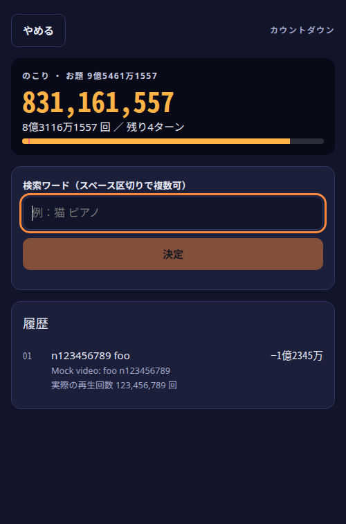
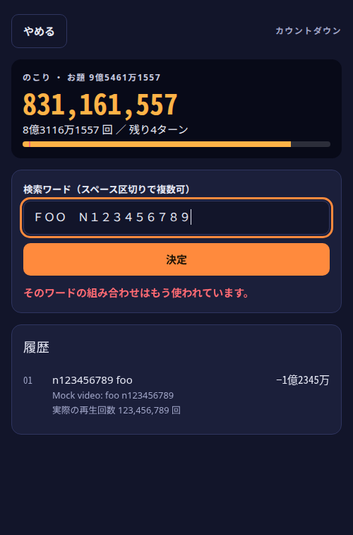
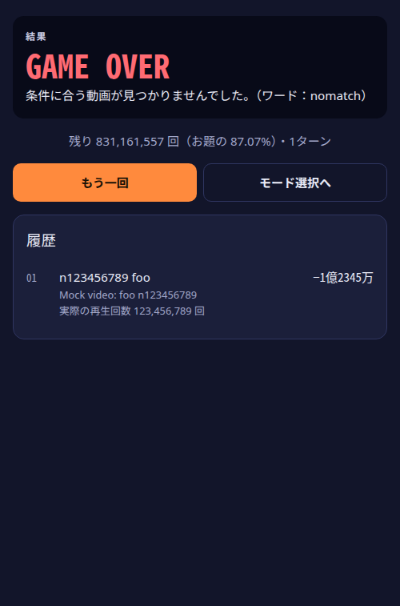
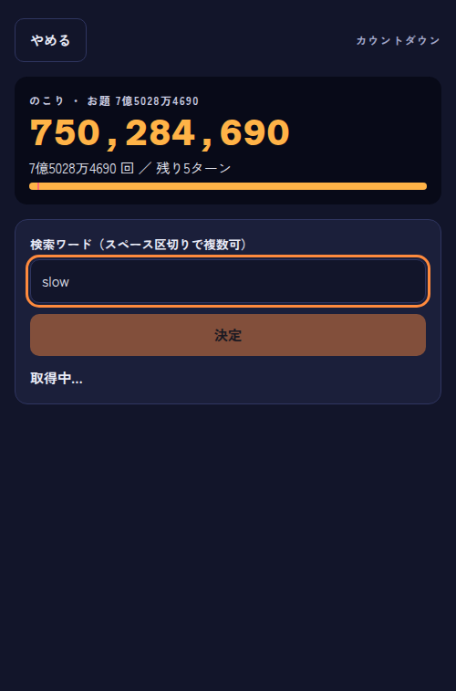
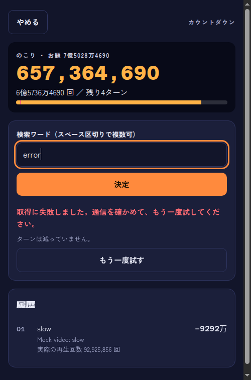
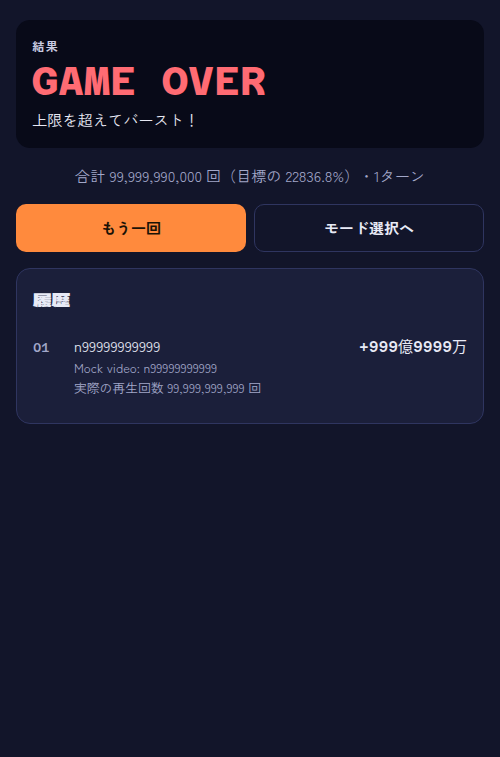
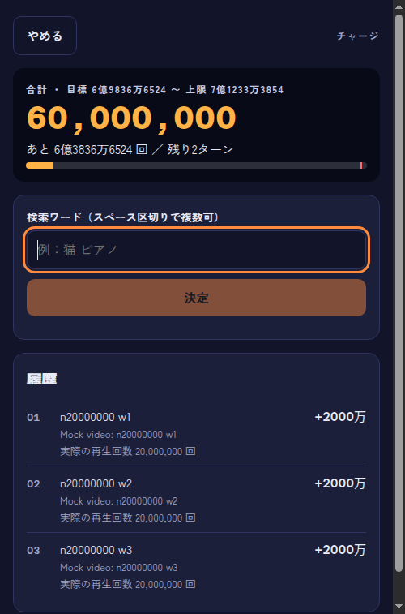
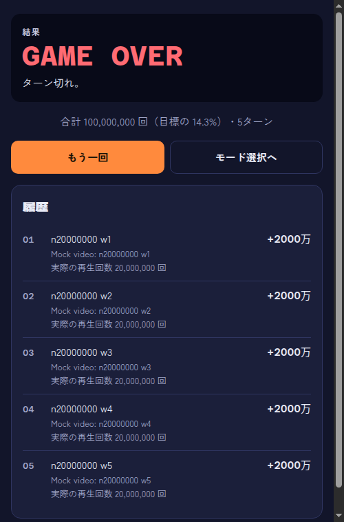
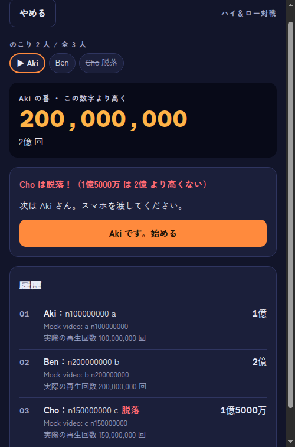
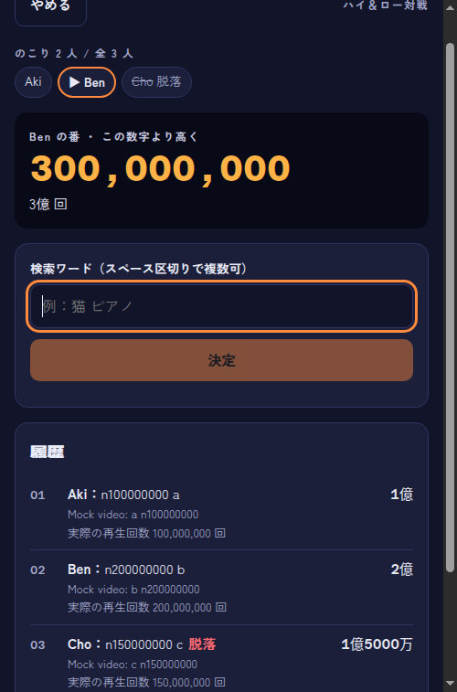
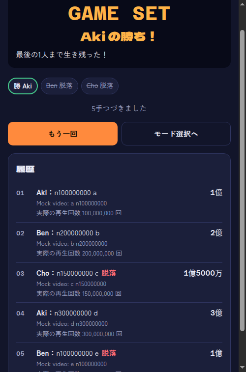
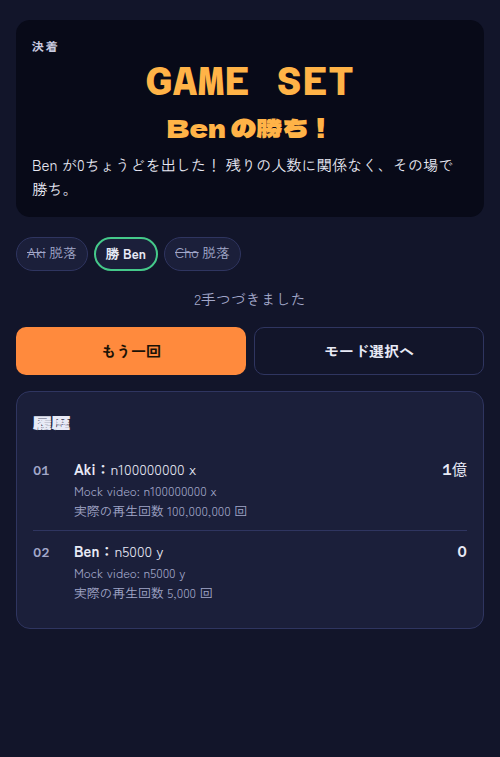

## 出力の全文
実行時の標準出力は、場面ごとの「確認 OK」の行がすべて OK で、`browser.mjs の終了コード：0`、`npm test の終了コード：0`、`go test の終了コード：0` だった。全文は `shots/20261028T154226/report.json` と、セッションの実行ログにある。実行後、Go と Vite のプロセスが残っていないことを `ss -ltnp` で確かめた。
