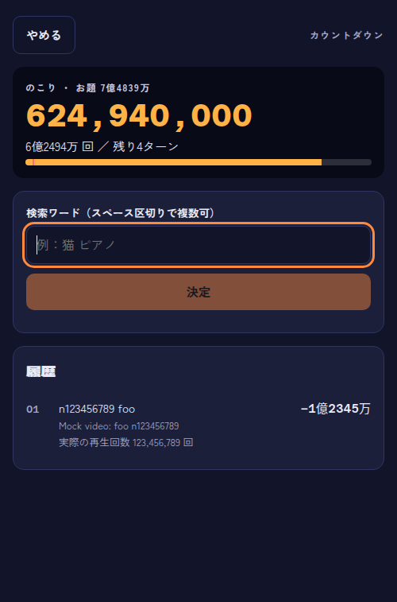
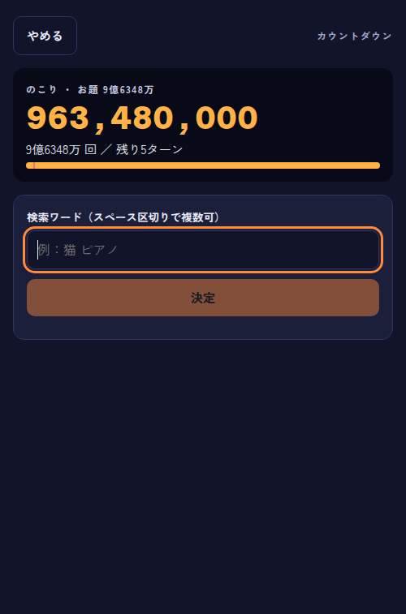
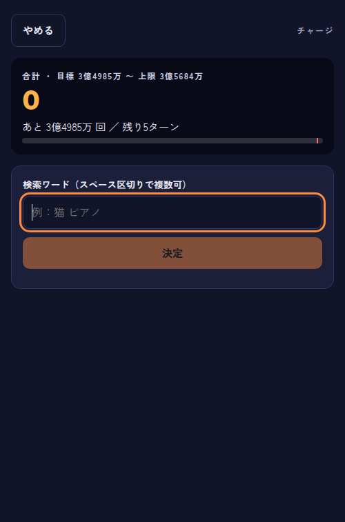
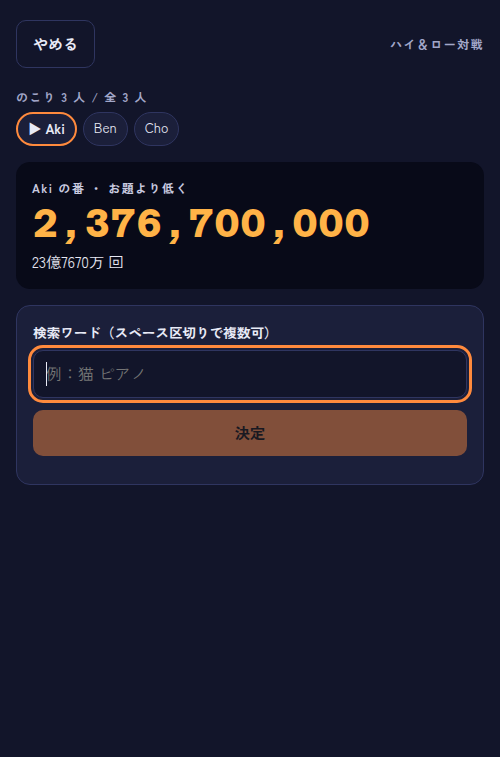

# Sprint 2 のリハーサル
- 日時：2026-10-28T19:01:28+09:00
- 回：2（見せ直し。1回目の記録は rehearsal-1.md）
- 実行したコマンド：`bash .scrum/demos/sprint-2/demo.sh /home/kal24hi/Projects/view-counter-game/.claude/worktrees/sprint-2 --rehearse`（コード：/home/kal24hi/Projects/view-counter-game/.claude/worktrees/sprint-2、統合コミット 3333ea5）

| # | 期待する結果 | 実際の出力（要点） | 判定 |
|---|---|---|---|
| 1 | 残りが切り捨て値で減る。履歴に切り捨て値・正しい再生回数・動画タイトル。 | 履歴に「−1億2345万」「実際の再生回数 123,456,789 回」「Mock video: foo n123456789」。残り4ターン。お題は「7億4839万」、残りは 624,940,000。 | 一致 |
| 2 | 語順や全角半角を変えた同じワードは拒否される。 | 2つとも「そのワードの組み合わせはもう使われています。」。履歴1行、残り4ターンのまま。 | 一致 |
| 3 | `nomatch` で GAME OVER。 | 1回目と同じ。 | 一致 |
| 4 | `slow` で「取得中…」とボタンの無効化。`error` でエラーと再試行、ターンが減らない。 | 1回目と同じ。 | 一致 |
| 5a | チャージでバースト。 | 1回目と同じ。 | 一致 |
| 5b | 合計がバーに積まれ、ターン切れ。 | 1回目と同じ。 | 一致 |
| 5c | チャージのクリア（手で試す）。 | 目標がランダムなため自動の場面に入れていない。境界値のテストで示した。 | 未達（自動化の対象外。テストで代替） |
| 6 | 脱落・手番の飛ばし・最後の1人の勝ち。 | 1回目と同じ。「Aki の勝ち！」。 | 一致 |
| 7 | 「前より低く」で0ちょうどの即勝利。 | 1回目と同じ。「Ben の勝ち！」。 | 一致 |
| 8a | カウントダウンのお題が万の位まで（3難易度）。 | やさしい「2億7644万」（276,440,000）、ふつう「9億6348万」（963,480,000）、むずかしい「12億509万」（1,205,090,000）。 | 一致 |
| 8b | チャージの目標と上限が万の位まで（3難易度）。 | やさしい「目標 1億9937万 〜 上限 2億933万」、ふつう「目標 3億4985万 〜 上限 3億5684万」、むずかしい「目標 26億4635万 〜 上限 26億5958万」。上限は目標×(1+許容幅) を1万単位に切り下げた値と一致する（例：349,850,000×1.02＝356,847,000 → 3億5684万）。 | 一致 |
| 8c | 対戦「前より低く」の最初のお題が万の位まで。 | 「お題より低く 2,376,700,000 23億7670万 回」。 | 一致 |
| 補足 | テストがすべて通る。 | web 9ファイル 124件 pass、Go 5パッケージ ok。 | 一致 |

## 画面で気づいた点（判定は変えない）
- 見出し「履歴」の字形が二重に重なったように見える（1回目と同じ）。レイアウトの崩れやエラーは無い。
- 場面 8a〜8c の確認は、端数が付いたときに出る「万1」〜「万9」を含まないことで判定している。お題がちょうど◯億（約1万分の1）のときだけ、この確認は端数の不具合を見逃す。誤って失敗する経路は無い。

## 画面

## 出力の全文
場面ごとの「確認 OK」の行がすべて OK で、`browser.mjs の終了コード：0`、`npm test の終了コード：0`、`go test の終了コード：0` だった。全文は `shots/20261028T190128/report.json` と、セッションの実行ログにある。
