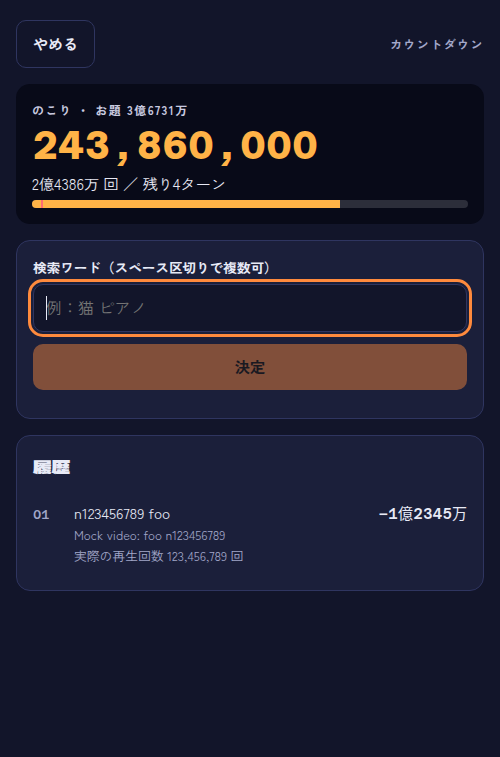
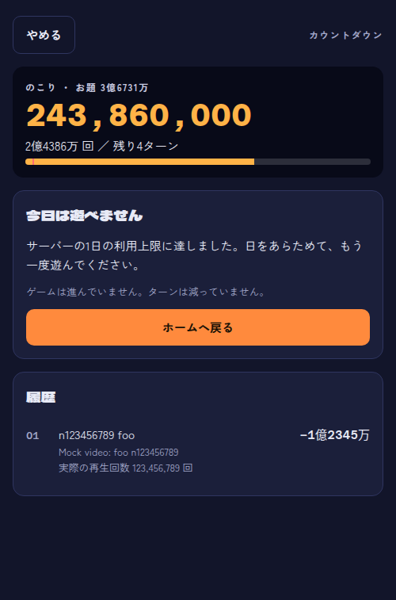
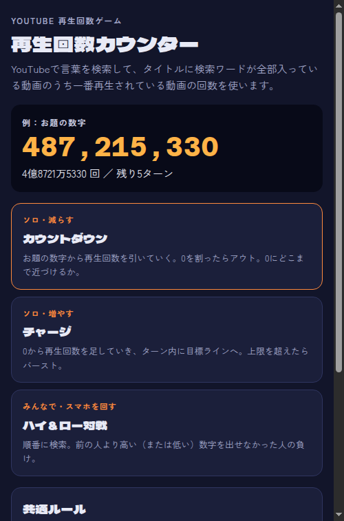

# Sprint 4 のリハーサル
- 日時：2026-10-28T22:05:53+09:00
- 回：1
- 実行したコマンド：`bash .scrum/demos/sprint-4/demo.sh /home/kal24hi/Projects/view-counter-game/.claude/worktrees/sprint-4 --rehearse`（コード：/home/kal24hi/Projects/view-counter-game/.claude/worktrees/sprint-4）
- 結果：確認 NG 0。終了後に残った待ち受けは無い（`ss -ltnp` は 9099・631・53・8080 の既存のものだけ）。

| # | 期待する結果 | 実際の出力（要点） | 判定 |
|---|---|---|---|
| 1 | `make vuln` と `make test-race` が検出0件で正常終了し、全パッケージ ok（#21） | `go.mod` に `toolchain go1.26.10`・`x/text v0.39.0`、Makefile に `golang:1.26.10-bookworm`。`make vuln` は終了コード 0、「No vulnerabilities found. Your code is affected by 0 vulnerabilities.」（module レベルの未呼び出し1件の注記あり）。`make test-race` は5パッケージ ok | 一致 |
| 2 | `RATE_LIMIT=3` で4回目に 429 と `Retry-After`。長すぎるワードと6語は 400 。静的ファイルは数えない（#7） | 200・200・200・429（`Retry-After: 60`、`too_many_requests`）。51文字は 400「1語50文字以内」、6語は 400「5語以内」、5語は 200。`TestRateLimitSkipsNonAPIPaths`・`TestClientIP`（13件）・`TestSpoofedXFFDoesNotBypassLimit` が PASS | 一致 |
| 3 | `q=quota` で2回とも 503 と `quota_exceeded`（#10） | 2回とも 503 `quota_exceeded`。`TestQuotaVersusOtherUpstreamErrors` の9件が PASS（`dailyLimitExceeded` は 502） | 一致 |
| 4 | カウントダウンの途中で `quota` を入れると「今日は遊べません」が出て、GAME OVER にならず、残りターンも変わらない。再試行が無く、ホームへ戻れる（#11） | `browser.mjs` の確認 14 件がすべて OK（残り4ターン・履歴1行のまま、`result-heading`・`retry-button`・`search-input` が0個、`quota-home` でモード選択へ）。`quota.test.tsx` 7件 pass（チャージ・対戦を含む） | 一致 |
| 5 | 応答しない偽サーバへの呼び出しが打ち切られ PASS（#22） | `TestNilHTTPClientHasTimeout`・`TestDefaultHTTPTimeoutIsTenSeconds`・`TestNilHTTPClientTimeoutOnHangingServer`（0.05s）が PASS。`youtube.go` に `http.DefaultClient` は無い | 一致 |

## 1回目の実行での不一致と対応
- 2026-10-28T22:03 の実行で、場面2が 200・200・429・429 になった（確認 NG 1）。
- 原因：デモスクリプトの起動確認が `/api/views?q=ready` を叩き、制限の3回のうち1回を使っていた。実装（#7）の不具合ではない。
- 対応：起動確認を `/`（数えられないパス）に向けた（golang-pro）。直した後の実行が、上の表である。

## 画面
画面は崩れておらず、エラーも出ていない。スマホ幅（390px）で確かめた。





## 出力の全文
`go test -v` のサブテストの行（`=== RUN` と `--- PASS` の各行）は、件数だけを残して省いた。

```
== 場面 1: make vuln と make test-race（#21） ==
--- go.mod ---
3:go 1.25.0
5:toolchain go1.26.10
7:require golang.org/x/text v0.39.0
--- Makefile のイメージの行 ---
3:GO_IMAGE := golang:1.26.10-bookworm
4:GOVULNCHECK_VERSION := v1.9.0
確認 OK: x/text v0.39.0、toolchain go1.26.10、イメージ golang:1.26.10-bookworm

$ make vuln
docker run --rm -v ".../sprint-4/server":/src:ro -w /src golang:1.26.10-bookworm go run golang.org/x/vuln/cmd/govulncheck@v1.9.0 ./...
=== Symbol Results ===

No vulnerabilities found.

Your code is affected by 0 vulnerabilities.
This scan also found 0 vulnerabilities in packages you import and 1
vulnerability in modules you require, but your code doesn't appear to call these
vulnerabilities.
Use '-show verbose' for more details.
終了コード: 0
確認 OK: make vuln が終了コード 0、呼び出される脆弱性は 0 件（module レベルの未呼び出しの検出は出力に残りうる）

$ make test-race
ok  	github.com/kalKun24/view-counter-game/server	1.062s
ok  	github.com/kalKun24/view-counter-game/server/internal/api	1.136s
ok  	github.com/kalKun24/view-counter-game/server/internal/cache	1.023s
ok  	github.com/kalKun24/view-counter-game/server/internal/words	1.021s
ok  	github.com/kalKun24/view-counter-game/server/internal/youtube	1.108s
終了コード: 0
確認 OK: 全パッケージ ok（ok 行 5 件、FAIL なし）

== 場面 2: RATE_LIMIT=3 で起動して curl を4回、長すぎるワードと語数超過、静的ファイルと XFF（#7） ==
（1〜3回目）HTTP 200 {"found":true,"viewCount":13997407,"video":{"id":"mock:foo","title":"Mock video: foo"}}
（4回目）HTTP 429
Retry-After: 60
{"error":{"code":"too_many_requests","message":"リクエストが多すぎます。しばらく待ってからもう一度お試しください。"}}
確認 OK: 1〜3回目は 200、4回目は 429 で Retry-After があり too_many_requests
（51文字）HTTP 400 {"error":{"code":"invalid_query","message":"検索ワードは1語50文字以内にしてください。"}}
確認 OK: 51文字のワードは 400 invalid_query
（6語）HTTP 400 {"error":{"code":"invalid_query","message":"検索ワードは5語以内にしてください。"}}
確認 OK: 6語の q は 400 invalid_query
（5語）HTTP 200
確認 OK: 5語の q は 200
--- PASS: TestRateLimitSkipsNonAPIPaths
--- PASS: TestClientIP（サブテスト 13 件）
--- PASS: TestSpoofedXFFDoesNotBypassLimit
確認 OK: 静的ファイルを数えないこと、クライアント IP の取り方、偽の X-Forwarded-For で回避できないことが PASS

== 場面 3: q=quota で curl を2回（#10） ==
（1回目・2回目）HTTP 503 {"error":{"code":"quota_exceeded","message":"YouTube API の利用上限に達しました。しばらくしてからもう一度お試しください。"}}
確認 OK: 2回とも 503 と quota_exceeded（キャッシュされず、同じ応答）
--- PASS: TestQuotaVersusOtherUpstreamErrors（サブテスト 9 件）
確認 OK: quotaExceeded は 503、dailyLimitExceeded を含む他の 403 は 502 であることが PASS

== 場面 4: カウントダウンの途中で quota を入れる（#11） ==
  確認 OK：[data-testid=counter-turns] が "残り5ターン" を含む
  入力：[data-testid=search-input] ← "n123456789 foo"
  確認 OK：[data-testid=log-row] が 1 を個数とする
  確認 OK：[data-testid=counter-turns] が "残り4ターン" を含む
  入力：[data-testid=search-input] ← "quota"
  確認 OK：[data-testid=quota-title] が "今日は遊べません" を含む
  確認 OK：[data-testid=result-heading] が 0 を個数とする
  確認 OK：[data-testid=counter-turns] が "残り4ターン" を含む
  確認 OK：[data-testid=log-row] が 1 を個数とする
  確認 OK：[data-testid=retry-button] が 0 を個数とする
  確認 OK：[data-testid=search-input] が 0 を個数とする
  確認 OK：[data-testid=quota-home] が 1 を個数とする
  押す：[data-testid=quota-home]
  確認 OK：[data-testid=quota-notice] が 0 を個数とする
  確認 OK：[data-testid=mode-countdown] が 1 を個数とする
browser.mjs の終了コード：0
確認 OK: 「今日は遊べません」が出て、GAME OVER にならず、残りターンも変わらない。再試行ボタンが無く、ホームへ戻れる
 Test Files  1 passed (1)
      Tests  7 passed (7)
確認 OK: quota.test.tsx が全件 pass

== 場面 5: go test ./internal/youtube/ -run Timeout -v（#22） ==
--- PASS: TestNilHTTPClientHasTimeout (0.00s)
--- PASS: TestDefaultHTTPTimeoutIsTenSeconds (0.00s)
--- PASS: TestNilHTTPClientTimeoutOnHangingServer (0.05s)
確認 OK: 応答しない偽サーバへの呼び出しが打ち切られ、PASS（3 件）
（見つからない）
確認 OK: youtube.go に http.DefaultClient が無い
70:		hc = &http.Client{Timeout: defaultHTTPTimeout}
76:const DefaultHTTPTimeout = 10 * time.Second
80:var defaultHTTPTimeout = DefaultHTTPTimeout

デモ終了（確認 NG: 0）
```
