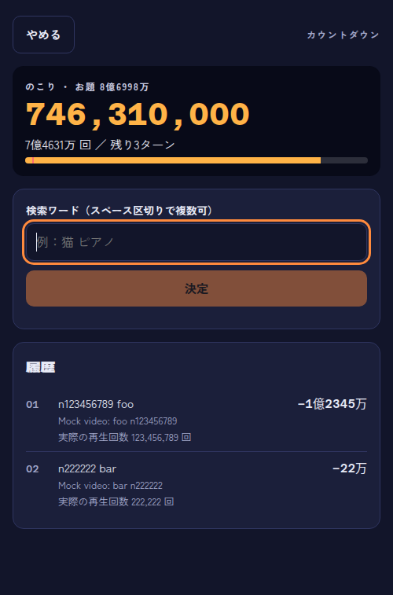
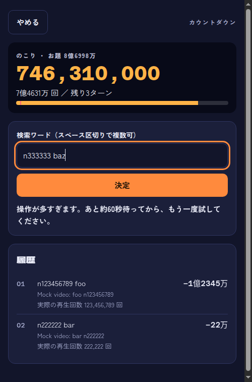

# Sprint 5 のリハーサル
- 日時：2026-10-31T13:27:02+09:00
- 回：1
- 実行したコマンド：`bash .scrum/demos/sprint-5/demo.sh /home/kal24hi/Projects/view-counter-game/.claude/worktrees/sprint-5 --rehearse`（コード：/home/kal24hi/Projects/view-counter-game/.claude/worktrees/sprint-5）
- 結果：確認 NG 0。終了後に残った待ち受けは無い（`ss -ltnp` は 9099・631・53・8080 の既存のものだけ）。

| # | 期待する結果 | 実際の出力（要点） | 判定 |
|---|---|---|---|
| 1 | 上限 202 で違うワードを3回送ると、1・2回目は 200、3回目は 503 `quota_exceeded`。ログに「daily unit limit reached」が1回。1回目のワードの再送はキャッシュから 200（#26） | `alpha`・`beta` は 200、`gamma` は 503 `quota_exceeded`、`alpha` の再送は 200。WARN「daily unit limit reached; upstream calls stopped until the next Pacific day」が1行（`used=202 limit=202 day=2026-10-30`。太平洋時間の日付） | 一致 |
| 2 | 上限 1000 で `quota` を送ると 503。後の2つも 503 で上流を呼ばない。抑制の開始のログは1回。1時間と太平洋 0 時の境界のテストが PASS（#26） | `quota`・`delta`・`epsilon` がすべて 503（`delta`・`epsilon` はモックなら 200 になるワード）。「upstream calls suppressed after quotaExceeded」（`suppressedFor=1h0m0s`）が1回、上流の「youtube quota exceeded」も1回だけ。`TestLimitBoundary`・`TestPacificMidnightResets`・`TestPacificMidnightInWinter`・`TestSuppressionBoundaryAndResume` が PASS | 一致 |
| 3 | `make vuln` が `No vulnerabilities found.` だけで終わり、「modules you require」の注記が無い。`x/text v0.41.0` と `@sha256:` つきのイメージ（#28） | `go.mod` は `x/text v0.41.0`・`toolchain go1.26.10`、Makefile は `golang:1.26.10-bookworm@sha256:386f0cbb...`。`make vuln` は `No vulnerabilities found.` のみ、終了コード 0 | 一致 |
| 4 | `RATE_LIMIT=2` のカウントダウンで3回目に「操作が多すぎます。あと約N秒…」が出る。ターンと履歴は2回目の後のまま、入力したワードは残る。再試行ボタンとエラー表示は無い（#25） | `browser.mjs` の確認 9 件がすべて OK。3回目に「操作が多すぎます。あと約60秒待ってから、もう一度試してください。」、残り3ターン・履歴2行のまま、`retry-button`・`error-message` は 0 個。画面で、入力欄に `n333333 baz` が残っていることも確かめた。`throttle.test.tsx` 32 件 pass | 一致 |

## 画面
画面は崩れておらず、エラーも出ていない。スマホ幅（390px）で確かめた。文言は赤ではなく通常の色で、通信失敗と見分けられる（UI 仕様どおり）。

- 「履歴」の見出しの文字がにじんで見える。Sprint 4 の画面（`../sprint-4/shots/20261028T220542/scene-4-before-quota.png`）でも同じで、ヘッドレスの Chrome のフォントの表示によるものである。今回の変更とは関係しない。




## 出力の全文
`go: downloading` の行は省いた。

```
== 準備: Go サーバをビルドする（コード：.../sprint-5/server） ==
ビルド完了

== 場面 1: DAILY_UNIT_LIMIT=202 で起動し、違うワードで curl を3回、1回目のワードをもう一度（#26） ==
上限 202 ユニット（検索1回 = search 100 + videos 1 = 101）のサーバ：http://127.0.0.1:49929（モック）

$ curl 'http://127.0.0.1:49929/api/views?q=alpha'
HTTP 200  {"found":true,"viewCount":58788115,"video":{"id":"mock:alpha","title":"Mock video: alpha"}}

$ curl 'http://127.0.0.1:49929/api/views?q=beta'
HTTP 200  {"found":true,"viewCount":19439247,"video":{"id":"mock:beta","title":"Mock video: beta"}}

$ curl 'http://127.0.0.1:49929/api/views?q=gamma'
HTTP 503  {"error":{"code":"quota_exceeded","message":"YouTube API の利用上限に達しました。しばらくしてからもう一度お試しください。"}}

$ curl 'http://127.0.0.1:49929/api/views?q=alpha'   （1回目のワードをもう一度）
HTTP 200  {"found":true,"viewCount":58788115,"video":{"id":"mock:alpha","title":"Mock video: alpha"}}

--- サーバのログ（WARN 以上） ---
time=2026-10-31T13:26:06.667+09:00 level=WARN msg="daily unit limit reached; upstream calls stopped until the next Pacific day" used=202 limit=202 day=2026-10-30
確認 OK: 1・2回目は 200、3回目は 503 quota_exceeded、1回目のワードの再送はキャッシュから 200
確認 OK: ログに「daily unit limit reached」が 1 回だけ出た

== 場面 2: 上限を 1000 にして quota を送り、そのあと別のワードを2つ（#26） ==
上限 1000 ユニットのサーバ：http://127.0.0.1:59701（モック）

$ curl 'http://127.0.0.1:59701/api/views?q=quota'
HTTP 503  {"error":{"code":"quota_exceeded","message":"YouTube API の利用上限に達しました。しばらくしてからもう一度お試しください。"}}

$ curl 'http://127.0.0.1:59701/api/views?q=delta'
HTTP 503  {"error":{"code":"quota_exceeded","message":"YouTube API の利用上限に達しました。しばらくしてからもう一度お試しください。"}}

$ curl 'http://127.0.0.1:59701/api/views?q=epsilon'
HTTP 503  {"error":{"code":"quota_exceeded","message":"YouTube API の利用上限に達しました。しばらくしてからもう一度お試しください。"}}

--- サーバのログ（WARN 以上） ---
time=2026-10-31T13:26:06.731+09:00 level=WARN msg="upstream calls suppressed after quotaExceeded" suppressedFor=1h0m0s until=2026-10-31T14:26:06+09:00
time=2026-10-31T13:26:06.731+09:00 level=ERROR msg="youtube quota exceeded" err="youtube: upstream status 403 (quotaExceeded)"
確認 OK: quota も、後の2つ（モックなら 200 になるワード）も 503。上流を呼んでいない
確認 OK: 抑制の開始のログは 1 回だけ。上流の quotaExceeded を受けたのも 1 回だけ（後の2つは上流に届いていない）

$ go test -v ./internal/quota/ -run 'TestSuppressionBoundaryAndResume|TestPacificMidnightResets|TestPacificMidnightInWinter|TestLimitBoundary'
=== RUN   TestLimitBoundary
--- PASS: TestLimitBoundary (0.00s)
=== RUN   TestPacificMidnightResets
--- PASS: TestPacificMidnightResets (0.00s)
=== RUN   TestPacificMidnightInWinter
--- PASS: TestPacificMidnightInWinter (0.00s)
=== RUN   TestSuppressionBoundaryAndResume
--- PASS: TestSuppressionBoundaryAndResume (0.00s)
PASS
ok  	github.com/kalKun24/view-counter-game/server/internal/quota	0.003s
終了コード: 0
確認 OK: 1時間の抑制の境界（59分59秒と1時間ちょうど）、太平洋時間 0 時の切り替え（PDT・PST）、上限の境界が PASS

== 場面 3: make vuln と go.mod・Makefile の該当行（#28） ==
--- go.mod ---
3:go 1.25.0
5:toolchain go1.26.10
7:require golang.org/x/text v0.41.0
--- Makefile のイメージの行 ---
4:GO_IMAGE := golang:1.26.10-bookworm@sha256:386f0cbb8fb3402ff5a15048c96731e6ff37142d31182f3b72306359a1f5e9b7
5:GOVULNCHECK_VERSION := v1.9.0
確認 OK: x/text v0.41.0、イメージは @sha256: で固定

$ make vuln
docker run --rm -v ".../sprint-5/server":/src:ro -w /src golang:1.26.10-bookworm@sha256:386f0cbb... go run golang.org/x/vuln/cmd/govulncheck@v1.9.0 ./...
No vulnerabilities found.
終了コード: 0
確認 OK: make vuln が終了コード 0 で「No vulnerabilities found.」。「modules you require」の注記は無い

== 場面 4: RATE_LIMIT=2 で起動し、カウントダウンで3回続けて検索する（#25） ==
Go サーバ：http://127.0.0.1:45075（モック、RATE_LIMIT=2、窓は既定の1分）
画面：http://127.0.0.1:46233/（スマホ幅で開くと見やすい。開発者ツールで幅 390px にする）
スクリーンショットの出力先：.../.scrum/demos/sprint-5/shots/20261031T132652

  開く：/
  押す：[data-testid=mode-countdown]
  待つ：[data-testid=setup-start]
  押す：[data-testid=setup-start]
  待つ：[data-testid=search-input]
  確認 OK：[data-testid=counter-turns] が "残り5ターン" を含む（実際："残り5ターン"）
  入力：[data-testid=search-input] ← "n123456789 foo"
  押す：[data-testid=search-submit]
  確認 OK：[data-testid=log-row] が 1 を個数とする（実際：1）
  確認 OK：[data-testid=counter-turns] が "残り4ターン" を含む（実際："残り4ターン"）
  入力：[data-testid=search-input] ← "n222222 bar"
  押す：[data-testid=search-submit]
  確認 OK：[data-testid=log-row] が 2 を個数とする（実際：2）
  確認 OK：[data-testid=counter-turns] が "残り3ターン" を含む（実際："残り3ターン"）
  画面：.../shots/20261031T132652/scene-4-before-throttle.png
  入力：[data-testid=search-input] ← "n333333 baz"
  押す：[data-testid=search-submit]
  待つ：[data-testid=throttle-message]
  確認 OK：[data-testid=throttle-message] が "操作が多すぎます。" を含む（実際："操作が多すぎます。あと約60秒待ってから、もう一度試してください。"）
  確認 OK：[data-testid=throttle-message] が "もう一度試してください。" を含む（実際："操作が多すぎます。あと約60秒待ってから、もう一度試してください。"）
  確認 OK：[data-testid=counter-turns] が "残り3ターン" を含む（実際："残り3ターン"）
  確認 OK：[data-testid=log-row] が 2 を個数とする（実際：2）
  確認 OK：[data-testid=search-input] が 1 を個数とする（実際：1）
  確認 OK：[data-testid=retry-button] が 0 を個数とする（実際：0）
  確認 OK：[data-testid=error-message] が 0 を個数とする（実際：0）
  画面：.../shots/20261031T132652/scene-4-throttled.png
browser.mjs の終了コード：0
確認 OK: 3回目に「操作が多すぎます。」が出る。ターンと履歴は2回目の後のまま。再試行ボタンとエラー表示は無い

$ npx vitest run src/throttle.test.tsx   （入力が残ること、秒数の出し方、対戦・チャージの扱いはテストで示す）
 Test Files  1 passed (1)
      Tests  32 passed (32)
終了コード: 0
確認 OK: throttle.test.tsx が全件 pass

デモ終了（確認 NG: 0）
```
